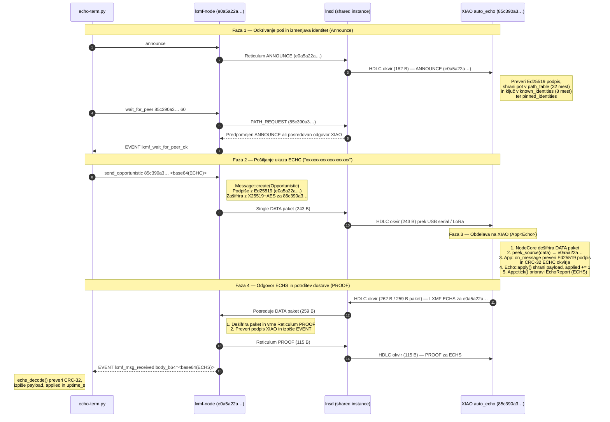

# Potek sporočil med Remote (`echo-term`) in LNode (`auto_echo` na XIAO Kit)

Ta dokument opisuje celoten protokolni in časovni potek izmenjave sporočil med gostiteljskim odjemalcem (`echo-term.py` + `lxmf-node` + `lnsd`) in vgrajenim vozliščem **Seeed XIAO nRF52840 + Wio-SX1262 (`auto_echo`)**.

---

## 1. Arhitektura sistema

```text
┌───────────────────┐   stdin/stdout    ┌───────────────────┐   Unix IPC socket   ┌───────────────────┐
│   echo-term.py    │ ────────────────▶ │     lxmf-node     │ ──────────────────▶ │       lnsd        │
│ (Python terminal) │ ◀──────────────── │ (Rust LXMF odjem.)│ ◀────────────────── │ (Reticulum daemon)│
└───────────────────┘   EVENT vrstice   └───────────────────┘    rns/default      └─────────┬─────────┘
                                                                                            │
                                                                     HDLC prek USB CDC-ACM  │ /dev/ttyACM1
                                                                     (ali LoRa 869.463 MHz) │ (serial_4)
                                                                                            ▼
                                                                                  ┌───────────────────┐
                                                                                  │  XIAO nRF52840    │
                                                                                  │   `auto_echo`     │
                                                                                  │NodeCore+App<Echo> │
                                                                                  └───────────────────┘
```

- **`echo-term.py`** ([tests/echo-term.py](../tests/echo-term.py)): kodira `ECHC` okvir (42 B), upravlja interaktivni terminal in dekodira prejeti `ECHS` okvir (50 B).
- **`lxmf-node`** (`leviculum-lxmf-node`): ustvari in podpiše opportunistično LXMF sporočilo (`send_opportunistic`) ter razpakira povratna LXMF sporočila v `EVENT lxmf_msg_received`.
- **`lnsd`** (`/etc/reticulum/config`): sistemski Reticulum daemon, ki drži serijska vrata `/dev/leviculum-xiao-transport-*` (`ttyACM1`) in usmerja pakete med lokalnimi IPC odjemalci ter strojno opremo.
- **`auto_echo`** (`leviculum-nrf/src/bin/auto_echo.rs`): firmware na XIAO nRF52840, ki teče brez `LxmfNode` predala (`delivery_destination_without_inbox`) in prek `App<Echo>` neposredno obdeluje `ECHC` ter vrača `ECHS`.

---

## 2. Sekvenčni potek sporočil



---

## 3. Plastna zgradba paketov na žici

Vsako sporočilo potuje skozi 4 ovojnice (od zunaj navznoter):

```text
+-----------------------------------------------------------------------------------+
| 1. HDLC serijski okvir (0x7E ... 0x7E, escaping 0x7D) — samo na USB CDC / UART    |
|  +-----------------------------------------------------------------------------+  |
|  | 2. Reticulum DATA paket (Header 19/35 B: flags, hops, dest_hash, context)   |  |
|  |  +-----------------------------------------------------------------------+  |  |
|  |  | 3. Šifriran tovor (X25519 efemerni ključ 32 B + AES-256-CBC + HMAC)   |  |  |
|  |  |    Dešifriran opportunistični LXMF paket:                             |  |  |
|  |  |    source_hash (16 B) + Ed25519 podpis (64 B) + msgpack[ts,t,c,fields]|  |  |
|  |  |  +-----------------------------------------------------------------+  |  |  |
|  |  |  | 4. Automation okvir v polju `content`:                          |  |  |  |
|  |  |  |    magic (4 B) + version (1 B) + payload (33/41 B) + crc32 (4 B)|  |  |  |
|  |  |  +-----------------------------------------------------------------+  |  |  |
|  |  +-----------------------------------------------------------------------+  |  |
|  +-----------------------------------------------------------------------------+  |
+-----------------------------------------------------------------------------------+
```

| Smer | Automation okvir | Velikost okvirja | Velikost Reticulum paketa |
|---|---|---|---|
| **Remote → XIAO** | `ECHC` (`"ECHC"` + `0x01` + `len(1)` + `payload[32]` + `crc32(4)`) | **42 B** | **243 B** |
| **XIAO → Remote** | `ECHS` (`"ECHS"` + `0x01` + `len(1)` + `payload[32]` + `applied(4)` + `uptime_s(4)` + `crc32(4)`) | **50 B** | **259 B** (`262 B` HDLC) |
| **Remote → XIAO** | Reticulum `PROOF` (potrditev prejema `ECHS` s podpisom `echo-term`) | — | **115 B** |

---

## 4. Razlaga izpisa na XIAO debug konzoli (`/dev/leviculum-xiao-debug`)

Primer dejanskega izpisa ob pošiljanju niza `xxxxxxxxxxxxxxxxxxx` (čas `t` je v milisekundah od zagona XIAO):

### Korak A: Prejem osvežitvene najave (`ANNOUNCE`) od `echo-term`
```text
[SER ] SER: USB read 64 t=497535
[SER ] SER: USB read 64 t=497535
[SER ] SER: USB read 56 t=497535
[SER ] SER: frame complete 182 t=497535
[INFO] SER RX 182 bytes t=497535
ANNOUNCE_LEARNED_NOT_RELAYED closed=rate_blocked discovery=none dest=e0a5a22a t=497587
```
- USB CDC gonilnik v 3 kosih (`64 + 64 + 56 B`) prebere HDLC okvir dolžine **182 B** (`ANNOUNCE` odjemalca `e0a5a22a`).
- V **52 ms** (`497535 → 497587 ms`) `NodeCore` preveri Ed25519 podpis najave in osveži tabelo poti ter ključev.
- `ANNOUNCE_LEARNED_NOT_RELAYED closed=rate_blocked`: XIAO je najavo sprejel lokalno, vendar je ni ponovno oddal naprej prek LoRa, ker je bila najava za `e0a5a22a` nedavno že posredovana (omejevanje pasovne širine).

### Korak B: Prejem ukaza `ECHC` in uveljavitev parametrov
```text
[SER ] SER: USB read 64 t=497735
[SER ] SER: USB read 64 t=497735
[SER ] SER: USB read 64 t=497735
[SER ] SER: USB read 53 t=497736
[SER ] SER: frame complete 243 t=497736
[INFO] SER RX 243 bytes t=497736
[AUTO] params=applied from=e0a5a22a verified=true t=497830
```
- Prejet je **243 B** Reticulum paket z opportunističnim LXMF sporočilom.
- V **94 ms** (`497736 → 497830 ms`) XIAO:
  1. Dešifrira paket z lastnim X25519 ključem,
  2. Prebere izvorno destinacijo (`e0a5a22a`) in poišče njeno javno identiteto,
  3. Preveri Ed25519 podpis pošiljatelja (`verified=true`),
  4. Preveri CRC-32 `ECHC` okvirja, shrani vsebino v `Echo` napravo, nastavi `target = e0a5a22a` in označi `report_due = true`.

### Korak C: Sestavljanje in pošiljanje odgovora `ECHS`
```text
[INFO!] [ECHO] reply sent dest=e0a5a22a t=497973
[T114_SERIAL_TX] pkt_hash8=0000e0a5a22a80bc len=259 t=497973
[SER ] SER: TX 259 t=497973
[SER ] SER: HDLC framed 262 t=497973
```
- V naslednjem koraku glavne zanke (`App::tick`) XIAO sestavi 50-bajtni `ECHS` okvir, ga podpiše z lastnim Ed25519 ključem in zašifrira za `e0a5a22a` (**143 ms**, `497830 → 497973 ms`).
- Paket dolžine **259 B** (oz. **262 B** po HDLC okvirjanju) se odda po USB serijski povezavi proti `lnsd`.
- **Celoten odzivni čas na XIAO** (od prejema zadnjega bajta `ECHC` do oddaje `ECHS`) znaša **237 ms** (`497736 → 497973 ms`).

### Korak D: Prejem potrditve `PROOF` od gostitelja
```text
[SER ] SER: USB read 64 t=497977
[SER ] SER: USB read 53 t=497977
[SER ] SER: frame complete 115 t=497977
[INFO] SER RX 115 bytes t=497977
```
- **4 ms** po oddaji `ECHS` (`497973 → 497977 ms`) `lxmf-node` na gostitelju prejme `ECHS` (ker ima njegov `lxmf.delivery` vključeno `ProofStrategy::All`) in vrne **115 B** podpisan Reticulum `PROOF` paket.

### Korak E: Periodični nadzor pomnilnika (`[STACK]` in `[HEAP_CENSUS]`)
```text
[STACK] min_free=78148 painted=101000 region=0x20006dc0..0x20020cf8 size=106296 peak_used=28148 sp=0x200207d0 tag=pre-reset t=498029
[STACK] min_free=101000 painted=101000 region=0x20006dc0..0x20020cf8 size=106296 peak_used=5296 sp=0x200207d0 tag=reset t=498036
[HEAP_CENSUS] used=49524 free=48780 largest=48732 node_box=31112 links=0 ...
```
- **`[STACK]`:** Vršna poraba klicnega sklada med kriptografskimi operacijami (Ed25519 + X25519) je bila `peak_used = 28148 B` (~27,5 KB od ~106 KB razpoložljivega sklada; prostih je ostalo `min_free = 78148 B`).
- **`[HEAP_CENSUS]`:** Poraba kopice (heap) je stabilna pri **49,5 KB**, prostih je **48,7 KB** v enem neprekinjenem bloku (`largest = 48732 B`).

---

## 5. Zaščita pred izrivanjem identitete v `EmbeddedStorage`

Na mikrokrmilniku nRF52840 uporablja `EmbeddedStorage` fiksne tabele:
- `known_identities`: **8 mest** (FIFO izrivanje ob polni tabeli)
- `path_table`: **32 mest**

Če je gostiteljski `lnsd` povezan z javnimi internetnimi Reticulum TCP vozlišči, posreduje internetne najave (`hops = 4..7`) tudi na serijski vmesnik XIAO. Po 8 takih najavah bi bila identiteta `echo-term` izrinjena iz `known_identities`, medtem ko bi njena pot v 32-mestni `path_table` še ostala:
1. **`auto_echo`** zato hrani do 8 bližnjih identitet (`hops <= 2`) in aktivni `app.target()` v `pinned_identities` ter jih pred klicem `send_single_packet` po potrebi obnovi z `node.remember_identity(...)`.
2. Če pot vseeno manjka, `auto_echo` pred `node.request_path(&target_hash)` pokliče `node.remove_path(&target)`, da predpomnjen odgovor iz `lnsd` ne pade na preverjanju `AnnounceReplay`.
3. **`echo-term.py`** v interaktivnem načinu osveži svoj `announce`, če je od zadnje najave minilo več kot 8 sekund.
